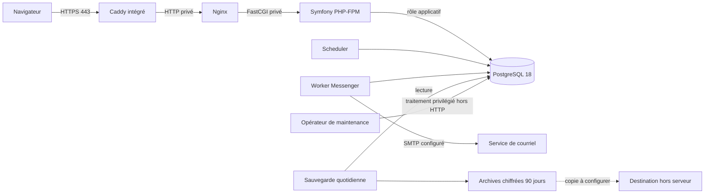
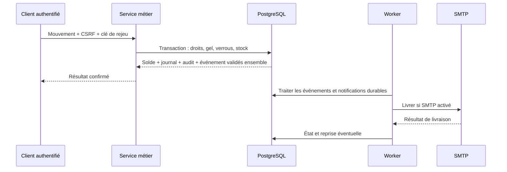

# Architecture du MVP

Symfony/Twig rend l’interface française ; Stimulus apporte les interactions locales sans frontend séparé. L’API utilise les mêmes règles métier. DBAL accède à PostgreSQL ; les migrations sont explicites. [Modèle de données et relations](modele-donnees.md) · [Contrat OpenAPI](openapi.json).

Le proxy HTTPS est ajouté par les overlays de production ; l’installation locale publie seulement Nginx sur loopback. Les réseaux isolent accès web et PostgreSQL. App, worker et scheduler utilisent le rôle applicatif, sans secret administrateur de base. Les services ont leurs sondes, espaces temporaires, limites de privilèges et journaux rotatifs. [Configuration détaillée](deploiement-production.md).

Une panne SMTP ne défait pas le stock validé. Les transferts verrouillent les deux magasins dans un ordre stable ; une clé rejouée ne refait pas le débit. Les corrections conservent l’original. Un inventaire gèle les mutations jusqu’à validation ou annulation. [Moteur transactionnel](moteur-stock.md).

La base, les files et les volumes restent sur **un seul serveur**. Le propriétaire accepte le risque résiduel de perte jusqu’à environ 24 h depuis la dernière sauvegarde quotidienne réussie ; la cible de reprise est un jour ouvré. Une copie hors serveur est nécessaire avant production. Toute restauration déclenche un verrou d’accès jusqu’au retraitement de conservation. Ni la réplication synchrone ni un second hébergement ne sont prévus au MVP.
