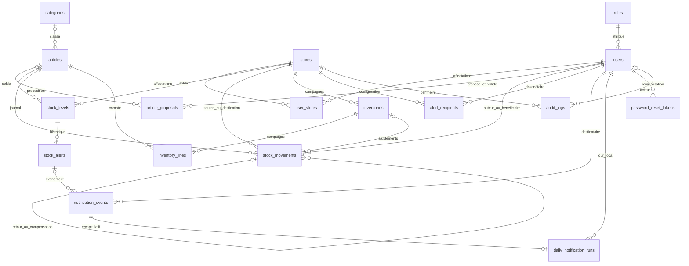

# Modèle de données — SOC-02

Le schéma PostgreSQL est défini dans `migrations/sql/001_schema.sql` et livré par la migration Doctrine `Version20261018010000`. Le code utilise DBAL ; aucune dépendance ORM ni génération automatique de schéma n’est nécessaire. Le modèle reprend les décisions de [suivi.md](../suivi.md).

## Relations

## Tables et invariants

| Table | Rôle et contraintes principales |
|---|---|
| `roles` | Trois codes de référence : ADMIN, MANAGER, USER. Un rôle par compte au MVP. |
| `users` | Courriel unique sans distinction de casse/espaces périphériques ; identité active ou compte anonymisé désactivé ; hash de mot de passe, version de session et fuseau. |
| `stores`, `user_stores` | Code magasin unique ; affectations multiples sans doublon ; statut logique. |
| `categories`, `articles` | Catégories hiérarchiques facultatives ; référence article unique et immuable ; unité technique `unit`, affichée « unité » ; archivage logique. |
| `article_proposals` | Proposition create/update avec payload séparé du catalogue publié, version de départ pour modification, auteur, décision et validateur. Une approbation nécessite une revue datée et l’article publié. |
| `stock_levels` | Un solde et des seuils par couple article/magasin ; quantité non négative ; seuil absent distinct de zéro ; seuil critique facultatif, inférieur ou égal au seuil bas. |
| `stock_movements` | Identifiant UUID immuable, type, article, source/destination, quantité positive, auteur, bénéficiaire, motif, référence métier facultative, clé d’idempotence unique par auteur. Mise à jour et suppression refusées par trigger. |
| `inventories` | Cinq états ; photographie exigée pendant comptage/validation/clôture ; validateur et date exigés pour clôture ; une seule campagne active par magasin. |
| `inventory_lines` | Couple inventaire/article unique ; théorique, compté nullable, auteur et date du comptage ; zéro est une saisie valide ; écart calculé en base. |
| `stock_alerts` | Historique bas/critique, une seule alerte active par article/magasin, seuil observé et dates d’ouverture/résolution. |
| `alert_recipients` | Configuration par magasin, personne et type. Les destinataires par défaut seront calculés à partir des administrateurs et gestionnaires dans ALT-03. |
| `notification_events` | Outbox durable : clé d’événement unique par envoi, destinataire, payload minimal, état, reprises et disponibilité ; les envois SMTP restent hors transaction métier. |
| `daily_notification_runs` | Un récapitulatif par destinataire et date locale Europe/Paris ; événement rattaché au même destinataire. |
| `password_reset_tokens` | Empreinte de jeton unique, expiration et date d’utilisation ; aucun jeton en clair. |
| `audit_logs` | Acteur, périmètre magasin facultatif, action, cible et contexte minimal ; UPDATE/DELETE refusés. |

Les identifiants métier sont des UUID générés par PostgreSQL. Les clés étrangères utilisent `RESTRICT` : retirer un objet référencé ne détruit jamais ses historiques en cascade. L’archivage utilise `active`. Les utilisateurs peuvent être anonymisés en conservant leur UUID et les références historiques ; la politique automatique à un an reste dans RGPD-01.

Les horodatages sont des `timestamptz` : ils représentent des instants, affichables dans le fuseau utilisateur. Les mouvements possèdent un horodatage serveur et aucune date métier rétroactive. L’écriture par l’application devra réserver cet horodatage au serveur, sans le prendre dans une requête client.

### Quantités exactes

Le domaine `stock_quantity` est un NUMERIC sans précision/échelle de conversion, avec vérification de l’intégralité et de la borne ±9 007 199 254 740 991. Cela évite l’arrondi silencieux qu’un cast SQL vers un entier ou un NUMERIC d’échelle zéro pourrait produire. `1.5`, même `0.000000001`, NaN, Infinity et les débordements sont refusés. Aucun flottant binaire n’intervient. Les sorties stockent une quantité positive ; leur sens est défini par les magasins source/destination. Les soldes et seuils ajoutent une contrainte non négative.

### Journal, retours et transferts

- Entrée : destination seule ; consommation : source seule et bénéficiaire obligatoire.
- Transfert : deux magasins distincts dans une ligne unique. La projection comptable produit exactement un débit et un crédit de même quantité.
- Ajustement : source seule (négatif) ou destination seule (positif), avec motif obligatoire.
- Retour : destination seule, lien obligatoire vers une consommation du même article et du magasin d’origine.
- Contre-mouvement : référence obligatoire, même article, sens inversé et quantité identique à l’opération compensée ; une compensation directe par original.

Le bénéficiaire n’a pas de lien contraint vers `user_stores`, puisqu’un technicien actif extérieur au magasin peut recevoir une consommation saisie par un gestionnaire/administrateur. Les vérifications de rôle, d’activité et de périmètre restent côté serveur dans AUTH-03/STK-04.

`stock_ledger` projette les sources négativement et les destinations positivement. `stock_reconciliation` compare la somme du journal au solde matérialisé, avec détection des soldes manquants. La commande `app:stock:reconcile` est strictement en lecture : code 0 si cohérent, code 1 et détails JSON en présence d’écarts ; aucune réparation automatique.

## Limites volontaires de SOC-02

Ce lot livre le stockage et ses garanties structurelles. Il n’enregistre pas encore de mouvements métier. STK-02 devra mettre à jour solde et journal dans la même transaction, vérifier le disponible sous verrou et traiter les relectures d’une clé avec une requête différente. STK-07 devra contrôler le cumul des retours sous verrou ; INV-01/03 implémenteront les transitions, le gel de tous les mouvements et l’immutabilité d’un inventaire clôturé. Les cycles de catégories, les rôles de validation des propositions et les règles d’état détaillées seront contrôlés par leurs services. MAIL-01 assurera l’écriture transactionnelle de l’outbox et sa publication vers Messenger ; MAIL-03 programmera le récapitulatif à 08 h.

Le hash de requête est prévu mais facultatif au niveau du stockage ; il deviendra obligatoire dans le service de création idempotente. Les payloads et contextes ne doivent contenir ni secrets, ni noms/courriels recopiés inutilement. L’historique est protégé contre UPDATE/DELETE usuels, pas contre un administrateur de base capable de modifier le schéma ou de désactiver ses triggers.

Index : mouvements par date, article/date, source/date, destination/date et consommateur/date ; liens inventaire et opération d’origine ; stocks par magasin ; alertes actives ; tâches de notification disponibles ; audit par acteur et magasin.

## Complément technique AUTH-02

La table `user_creation_requests` relie un administrateur et sa clé d’idempotence au compte créé et au résultat JSON initial. Sa transaction est commune à la création, aux affectations et à l’audit. L’empreinte est protégée par HMAC ; aucun corps de création ni mot de passe n’y est stocké. Le résultat contient l’identité initiale et relève donc aussi de la future rétention/anonymisation RGPD-01.
